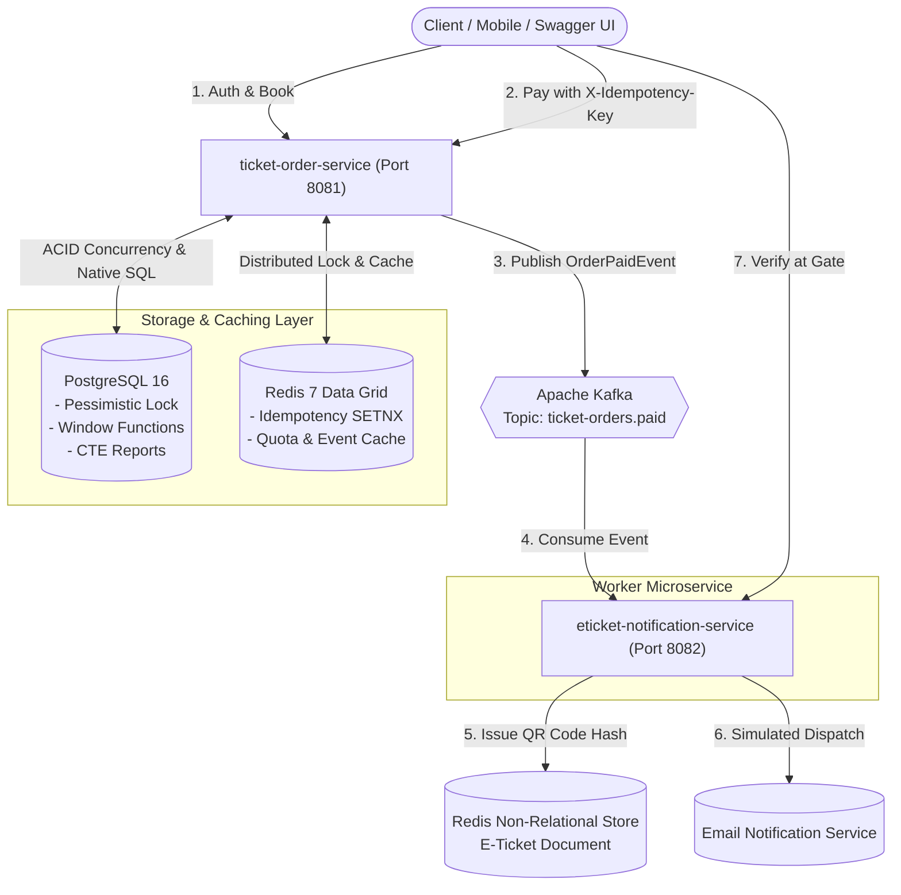

# Event Ticketing, Booking, Payment & E-Ticket Issuance Platform

[](https://openjdk.org/projects/jdk/21/)
[](https://spring.io/projects/spring-boot)
[]()
[]()

Platform mikroservis modern berkinerja tinggi untuk pemesanan tiket konser/event berskala besar (*high-concurrency ticket war*), pemrosesan pembayaran terproteksi idempotensi, dan penerbitan tiket elektronik (E-Ticket) asinkron berbasis Apache Kafka.

---

## 1. Arsitektur Sistem & Alur Bisnis

Sistem ini dirancang menggunakan arsitektur **Event-Driven Microservices** yang terbagi menjadi 2 modul layanan independen:



---

## 2. Pemenuhan Spesifikasi & Kriteria Teknis

Sistem ini memenuhi seluruh kualifikasi teknis mulai dari tingkat **Junior, Middle, hingga Senior**:

| Level | Persyaratan Teknis | Implementasi Nyata pada Proyek Ini |
| :--- | :--- | :--- |
| **Junior** | **Spring IoC & Architecture** | Inversi kontrol penuh via Constructor Injection (`@RequiredArgsConstructor`), pemisahan kontrak Interface & Implementasi (`OrderService` & `OrderServiceImpl`), isolasi konfigurasi, dan penanganan error terpusat (`@RestControllerAdvice`). |
| | **Java Stream API** | Pipeline agregasi analitik finansial di `ReportServiceImpl`: pemfilteran data, transformasi DTO, grouping multi-dimensi (`Collectors.groupingBy`), dan reduksi total omset (`reduce`, `summingLong`). |
| | **Native SQL Query** | Query native PostgreSQL untuk pencarian relasional kompleks dan join data berkinerja tinggi. |
| **Middle** | **Intermediate Native SQL** | **Pessimistic Locking (`SELECT ... FOR UPDATE`)**: Mengunci baris kuota tiket secara eksklusif di level database engine saat checkout untuk menjamin **tidak terjadi *overselling*** pada skenario *ticket war*. |
| | **Containerization & Microservices** | Multi-stage `Dockerfile` (Eclipse Temurin JRE 21 ringan) untuk kedua modul layanan + `docker-compose.yml` yang mengorkestrasi PostgreSQL, Redis, Kafka, dan 2 microservices dalam 1 kali perintah. |
| **Senior** | **Advance Native SQL Query** | • **Window Function:** Menghitung akumulasi omset berjalan (*running total revenue*) per event dan perangkingan transaksi (`SUM(total_amount) OVER (PARTITION BY event_id ORDER BY created_at)`).<br>• **CTE (Common Table Expressions):** Rekapitulasi hierarkis keterisian kuota (*occupancy rate*) multi-tier secara modular dan cepat (`WITH tier_metrics AS ...`). |
| | **Kafka & Stream Application** | Eksekusi pembayaran mempublikasikan `OrderPaidEvent` ke Kafka topic `ticket-orders.paid`. Modul `eticket-notification-service` mengonsumsinya secara asinkron tanpa memblokir thread pembayaran utama. |
| | **Redis & Caching Strategy** | • **Idempotency Key Protection:** Mencegah *double payment* akibat klik berulang atau koneksi lambat (`X-Idempotency-Key` di Redis dengan TTL 10 menit).<br>• **High-speed Cache:** Caching katalog event dan kuota di Redis dengan strategi invalidasi otomatis saat transaksi commit. |
| | **Non-Relational / Document DB** | Tiket elektronik disimpan dalam struktur dokumen cepat (Redis Key-Value & Data Grid) yang dioptimasi untuk pembacaan instan saat pemindaian QR di pintu masuk (*gate check-in*). |

---

## 3. Struktur Direktori Proyek

```text
event-ticketing-platform/
├── pom.xml                                      # Parent POM (Java 21, Spring Boot 3.3.5)
├── docker-compose.yml                           # 1-Click Run: Postgres, Redis, Kafka, 2 Services
├── README.md                                    # Dokumentasi Utama
│
├── ticket-order-service/                        # Service Utama (Port 8081)
│   ├── Dockerfile
│   └── src/main/java/com/fintech/ticket/
│       ├── common/constant/                    # ApiUrlConstant, AppConstant, SecurityConstant, dll
│       ├── common/response/                    # ApiResponse<T>
│       ├── config/                              # SecurityConfig, SwaggerConfig, RedisConfig, KafkaProducerConfig
│       ├── controller/                          # AuthController, EventController, OrderController, PaymentController, ReportController, AuditLogController
│       ├── dto/request/ & dto/response/         # Request & Response DTOs
│       ├── entity/                              # User, Role, Event, TicketTier, Order, Payment, AuditLog
│       ├── event/                               # OrderPaidEvent (Kafka Payload)
│       ├── exception/                           # GlobalExceptionHandler & Custom Exceptions
│       ├── repository/                          # JPA Repositories + Native Query (Window Func, CTE, FOR UPDATE)
│       ├── security/                            # JwtTokenProvider, JwtFilter, CustomUserDetailsService
│       └── service/impl/                        # Business Logic, Java Stream Analytics, Redis Idempotency
│
└── eticket-notification-service/                # Service Sekunder (Port 8082)
    ├── Dockerfile
    └── src/main/java/com/fintech/eticket/
        ├── common/                              # Constants & Response wrappers
        ├── config/                              # KafkaConsumerConfig, SwaggerConfig, RedisConfig
        ├── consumer/                            # OrderPaidKafkaConsumer
        ├── controller/                          # ETicketController
        ├── entity/                              # ETicket (Document/Entity)
        ├── repository/impl/                     # ETicketRepository (Redis Data Grid)
        └── service/impl/                        # ETicketService (QR Hashing, Email Simulator)
```

---

## 4. Cara Menjalankan Sistem

### Opsi A: Menjalankan Menggunakan Docker Compose (Direkomendasikan)
Cukup jalankan satu perintah dari root folder repositori:

```bash
docker compose up -d
```

Seluruh kontainer (PostgreSQL, Redis, Kafka, `ticket-order-service`, dan `eticket-notification-service`) akan menyala otomatis dan siap digunakan dalam beberapa detik.

Untuk menghentikan kontainer:
```bash
docker compose down
```

---

### Opsi B: Menjalankan Secara Lokal (Maven)
Pastikan Java 21 dan Maven 3.9+ sudah terpasang di komputer Anda.

1. **Jalankan dependensi database & broker** (Postgres, Redis, Kafka).
2. **Build seluruh project:**
   ```bash
   mvn clean package -DskipTests
   ```
3. **Jalankan Service 1 (Ticket Order Service):**
   ```bash
   cd ticket-order-service
   mvn spring-boot:run
   ```
4. **Jalankan Service 2 (ETicket Notification Service):**
   ```bash
   cd eticket-notification-service
   mvn spring-boot:run
   ```

---

## 5. Dokumentasi API Interaktif (Swagger UI)

Setelah layanan aktif, dokumentasi Swagger UI interaktif dapat diakses langsung melalui browser:

* **Ticket Order Service:** [http://localhost:8081/swagger-ui.html](http://localhost:8081/swagger-ui.html)
* **ETicket Notification Service:** [http://localhost:8082/swagger-ui.html](http://localhost:8082/swagger-ui.html)

---

## 6. Panduan Uji Coba Cepat (End-to-End Walkthrough)

### Kredensial Pengguna Awal (Seeded Data):
* **Admin:** Username: `admin` | Password: `AdminPass123!`
* **User:** Username: `fazri` | Password: `Password123!`

---

### Langkah 1: Autentikasi (Dapatkan Token JWT)
```bash
curl -X POST http://localhost:8081/api/v1/auth/login \
  -H "Content-Type: application/json" \
  -d '{
    "username": "fazri",
    "password": "Password123!"
  }'
```
*Salin nilai `data.accessToken` dari respons untuk digunakan pada header `Authorization: Bearer <token>` di langkah berikutnya.*

---

### Langkah 2: Lihat Katalog Event Konser & Sisa Kuota (Redis Cached)
```bash
curl -X GET http://localhost:8081/api/v1/events \
  -H "Authorization: Bearer <TOKEN>"
```

---

### Langkah 3: Booking Tiket Konser (Create Order)
```bash
curl -X POST http://localhost:8081/api/v1/orders \
  -H "Authorization: Bearer <TOKEN>" \
  -H "Content-Type: application/json" \
  -d '{
    "eventId": "<EVENT_ID>",
    "tierId": "<TIER_ID>",
    "quantity": 2
  }'
```

---

### Langkah 4: Bayar Tiket (Proteksi Idempotency Key & Pessimistic Lock)
Sertakan header wajib `X-Idempotency-Key` berupa UUID:

```bash
curl -X POST http://localhost:8081/api/v1/payments \
  -H "Authorization: Bearer <TOKEN>" \
  -H "X-Idempotency-Key: e827d091-8975-472d-8f24-2c1b2f7041a0" \
  -H "Content-Type: application/json" \
  -d '{
    "orderId": "<ORDER_ID>",
    "paymentMethod": "VIRTUAL_ACCOUNT"
  }'
```
*Coba kirim request yang sama sekali lagi dengan `X-Idempotency-Key` yang sama: sistem akan mendeteksi transaksi ganda secara otomatis dan tidak akan memotong kuota tiket dua kali.*

---

### Langkah 5: Cek Penerbitan E-Ticket di Service 2
```bash
curl -X GET http://localhost:8082/api/v1/etickets/order/<ORDER_NUMBER>
```

---

### Langkah 6: Periksa Laporan Finansial (Advance Native SQL)
* **Running Revenue & Ranking (Window Function):**
  ```bash
  curl -X GET http://localhost:8081/api/v1/reports/running-revenue \
    -H "Authorization: Bearer <TOKEN>"
  ```
* **Occupancy Summary (CTE):**
  ```bash
  curl -X GET http://localhost:8081/api/v1/reports/occupancy-summary \
    -H "Authorization: Bearer <TOKEN>"
  ```
* **Sales Analytics (Java Stream API):**
  ```bash
  curl -X GET http://localhost:8081/api/v1/reports/sales-analytics \
    -H "Authorization: Bearer <TOKEN>"
  ```

---

## 7. Audit Trail & Kepatuhan Keamanan
Semua mutasi finansial dan pemotongan kuota dicatat secara otomatis ke dalam tabel database `audit_logs` (mencakup aksi, entitas, ID, username, nilai lama, nilai baru, dan alamat IP). Log audit dapat diinspeksi melalui:

```bash
curl -X GET http://localhost:8081/api/v1/audits \
  -H "Authorization: Bearer <TOKEN>"
```

---

**Author:** Muhammad Fazri Deffara Riswandy  
**Position:** Backend Developer (Spring Boot)
