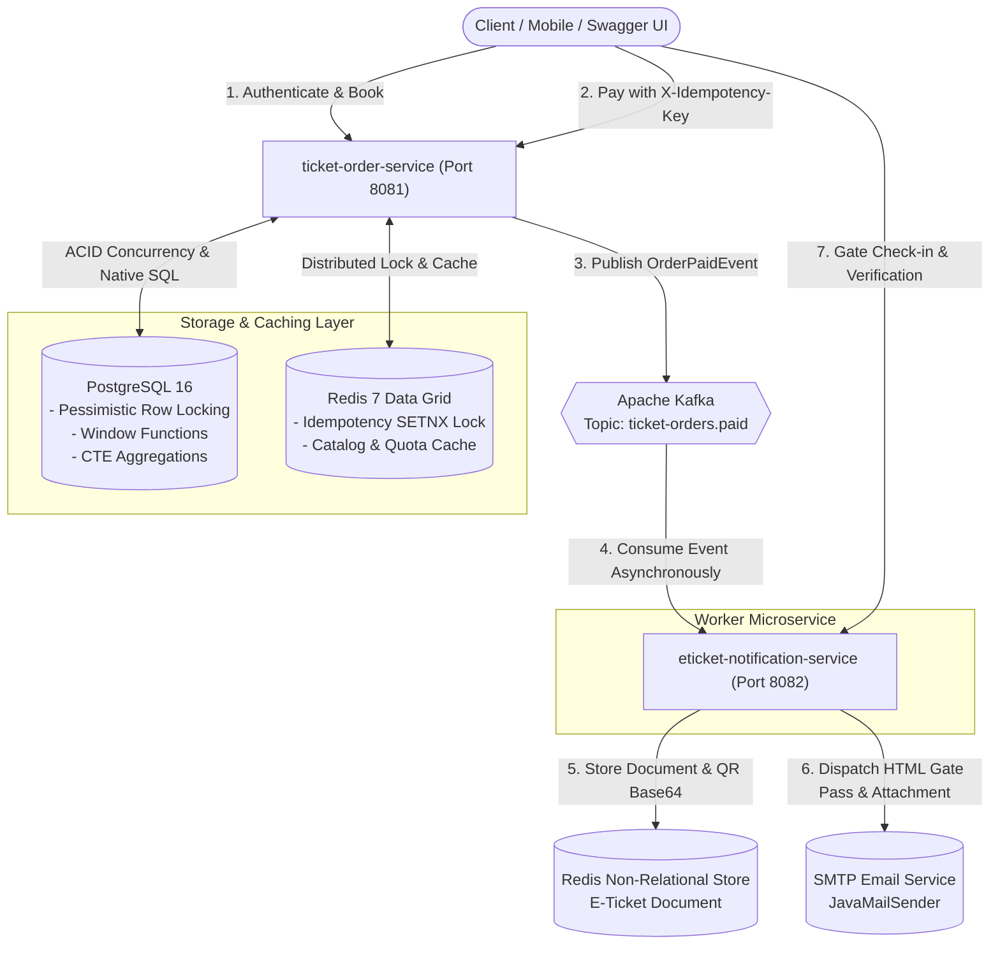

# Event Ticketing, Booking, Payment & E-Ticket Platform

[](https://openjdk.org/projects/jdk/21/)
[](https://spring.io/projects/spring-boot)
[](https://kafka.apache.org/)
[](https://www.postgresql.org/)
[](https://redis.io/)
[]()
[]()

A high-performance, distributed event ticketing platform engineered for high-concurrency ticket reservations, ACID-compliant payment processing with distributed idempotency protection, and asynchronous e-ticket fulfillment powered by Apache Kafka, dynamic QR code generation, and automated HTML email notifications.

---

## 1. System Architecture

The platform is designed around an **Event-Driven Microservices Architecture**, separating real-time financial checkout from asynchronous document generation and notification dispatch:



---

## 2. Core Architectural Highlights

- **High-Concurrency Ticket War Protection:** Database-level pessimistic write locking (`SELECT ... FOR UPDATE`) guarantees zero overselling across concurrent checkout requests.
- **Distributed Idempotency Protection:** Enforces unique transaction execution via Redis `SETNX` (10-minute TTL) on the `X-Idempotency-Key` header, preventing duplicate debiting from retried or double-clicked requests.
- **Event-Driven Asynchronous Processing:** Payment processing finishes in sub-50ms by delegating I/O-intensive operations (PDF/HTML rendering, ZXing QR code generation, and SMTP transport) to `eticket-notification-service` via Apache Kafka (`ticket-orders.paid`).
- **Cryptographic QR Pass & Gate Verification:** Each issued ticket embeds a SHA-256 cryptographic signature inside a high fault-tolerant QR code (ZXing Error Correction Level H, 30% damage tolerance). Entrance turnstile scanners can validate authenticity via single-use verification endpoints.
- **Advanced Financial Analytics:** PostgreSQL Window Functions for partition-based running revenue calculation and order ranking, Common Table Expressions (CTE) for hierarchical tier occupancy metrics, and Java Stream API in-memory aggregation pipelines.
- **Enterprise Audit Trail:** Automated auditing of all financial mutations and inventory changes into `audit_logs` tracking previous states, updated values, operator credentials, and client IP addresses.

---

## 3. Project Structure

```text
event-ticketing-platform/
├── pom.xml                                      # Parent POM (Java 21, Spring Boot 3.3.5)
├── docker-compose.yml                           # Full environment: PostgreSQL, Redis, Kafka, 2 Services
├── database/                                    # Database initialization & migration scripts
│   └── init.sql                                 # PostgreSQL DDL and sample seeds
├── README.md                                    # System Documentation
│
├── ticket-order-service/                        # Core Order & Payment Service (Port 8081)
│   ├── Dockerfile
│   └── src/main/java/com/fintech/ticket/
│       ├── common/                              # API URL definitions, constants, and unified response wrappers
│       ├── config/                              # Security, Swagger, Redis, and Kafka Producer configurations
│       ├── controller/                          # Auth, Event, Order, Payment, Report, and Audit controllers
│       ├── dto/                                 # Request and Response transfer objects
│       ├── entity/                              # JPA Domain models (User, Event, TicketTier, Order, Payment, AuditLog)
│       ├── event/                               # Kafka event message models (OrderPaidEvent)
│       ├── exception/                           # Global exception handling and custom business exceptions
│       ├── repository/                          # Repositories with Window Functions, CTE, and Row Locks
│       ├── security/                            # JWT token provider, authentication filter, UserDetailsService
│       └── service/impl/                        # Business transactions, Redis caching, and Stream reporting
│
└── eticket-notification-service/                # Fulfillment & Notification Worker (Port 8082)
    ├── Dockerfile
    └── src/main/java/com/fintech/eticket/
        ├── common/                              # Constants, API endpoints, and response models
        ├── config/                              # Kafka Consumer, Redis, and Swagger configurations
        ├── consumer/                            # OrderPaidKafkaConsumer
        ├── controller/                          # E-Ticket retrieval, HTML rendering, and Gate verification
        ├── entity/                              # ETicket document model with QR Base64 payload
        ├── repository/impl/                     # Redis Data Grid document repository
        └── service/impl/                        # ETicketService, QRCodeService (ZXing), EmailService (HTML + QR)
```

---

## 4. Getting Started

### Option A: Running with Docker Compose (Recommended)

Run the entire ecosystem with a single command from the root directory:

```bash
docker compose up -d
```

This starts:
- **PostgreSQL 16** (`localhost:5432`)
- **Redis 7** (`localhost:6379`)
- **Apache Kafka KRaft** (`localhost:9092`)
- **ticket-order-service** (`localhost:8081`)
- **eticket-notification-service** (`localhost:8082`)

To stop all services:
```bash
docker compose down
```

---

### Option B: Running Locally with Maven

Prerequisites: **JDK 21** and **Maven 3.9+**.

1. **Start dependencies** (PostgreSQL, Redis, Apache Kafka).
2. **Build all modules:**
   ```bash
   mvn clean package -DskipTests
   ```
3. **Start Service 1 (Ticket Order Service):**
   ```bash
   cd ticket-order-service
   mvn spring-boot:run
   ```
4. **Start Service 2 (ETicket Notification Service):**
   ```bash
   cd eticket-notification-service
   mvn spring-boot:run
   ```

---

## 5. Interactive API Documentation (Swagger UI)

Interactive OpenAPI / Swagger documentation is available once the services are running:

* **Ticket Order Service:** [http://localhost:8081/swagger-ui.html](http://localhost:8081/swagger-ui.html)
* **ETicket Notification Service:** [http://localhost:8082/swagger-ui.html](http://localhost:8082/swagger-ui.html)

---

## 6. End-to-End Walkthrough

### Pre-seeded User Credentials
* **Admin:** Username: `admin` | Password: `AdminPass123!`
* **User:** Username: `fazri` | Password: `Password123!`

---

### Step 1: Authentication (Obtain JWT Bearer Token)
```bash
curl -X POST http://localhost:8081/api/v1/auth/login \
  -H "Content-Type: application/json" \
  -d '{
    "username": "fazri",
    "password": "Password123!"
  }'
```
*Copy the `accessToken` from the response for subsequent requests.*

---

### Step 2: Browse Concert Catalog & Available Quota (Redis Cached)
```bash
curl -X GET http://localhost:8081/api/v1/events \
  -H "Authorization: Bearer <TOKEN>"
```

---

### Step 3: Book Concert Tickets (Create Order)
```bash
curl -X POST http://localhost:8081/api/v1/orders \
  -H "Authorization: Bearer <TOKEN>" \
  -H "Content-Type: application/json" \
  -d '{
    "eventId": "<EVENT_ID>",
    "tierId": "<TIER_ID>",
    "quantity": 2
  }'
```

---

### Step 4: Execute Payment (Pessimistic Lock & Idempotency Protection)
Include a unique UUID in the `X-Idempotency-Key` header:

```bash
curl -X POST http://localhost:8081/api/v1/payments \
  -H "Authorization: Bearer <TOKEN>" \
  -H "X-Idempotency-Key: e827d091-8975-472d-8f24-2c1b2f7041a0" \
  -H "Content-Type: application/json" \
  -d '{
    "orderId": "<ORDER_ID>",
    "paymentMethod": "VIRTUAL_ACCOUNT"
  }'
```
*If this request is retried with the same `X-Idempotency-Key`, the system detects the duplicate transaction and returns the previously processed result without deducting inventory twice.*

---

### Step 5: Verify E-Ticket Fulfillment & Email Dispatch (Service 2)

1. **Inquire E-Ticket Data & QR Code Base64:**
```bash
curl -X GET http://localhost:8082/api/v1/etickets/order/<ORDER_NUMBER>
```

2. **Render Responsive HTML Gate Pass in Browser:**
```text
http://localhost:8082/api/v1/etickets/render/<TICKET_CODE>
```

3. **Simulate Turnstile Gate Check-in:**
```bash
curl -X POST http://localhost:8082/api/v1/etickets/verify/<TICKET_CODE>
```
*When `OrderPaidEvent` is published, the notification worker generates the QR pass, stores it in the Redis document store, and dispatches an HTML email with the QR code image attachment to the buyer.*

---

### Step 6: Query Financial & Analytical Reports

* **Running Revenue & Transaction Ranking (Window Functions):**
  ```bash
  curl -X GET http://localhost:8081/api/v1/reports/running-revenue \
    -H "Authorization: Bearer <TOKEN>"
  ```
* **Tier Occupancy Summary (Common Table Expressions):**
  ```bash
  curl -X GET http://localhost:8081/api/v1/reports/occupancy-summary \
    -H "Authorization: Bearer <TOKEN>"
  ```
* **Sales Analytics (Java Stream API):**
  ```bash
  curl -X GET http://localhost:8081/api/v1/reports/sales-analytics \
    -H "Authorization: Bearer <TOKEN>"
  ```

---

## 7. Security & Audit Trail

All critical financial mutations and ticket quota decrements are recorded in the `audit_logs` table (including action, target entity, record ID, username, previous value, new value, timestamp, and client IP address). The audit trail can be inspected via:

```bash
curl -X GET http://localhost:8081/api/v1/audits \
  -H "Authorization: Bearer <TOKEN>"
```

---

**Author:** Muhammad Fazri Deffara Riswandy  
**Role:** Backend Software Engineer
